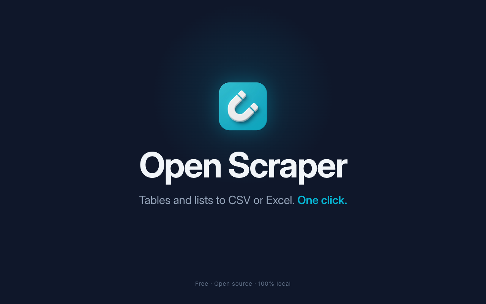
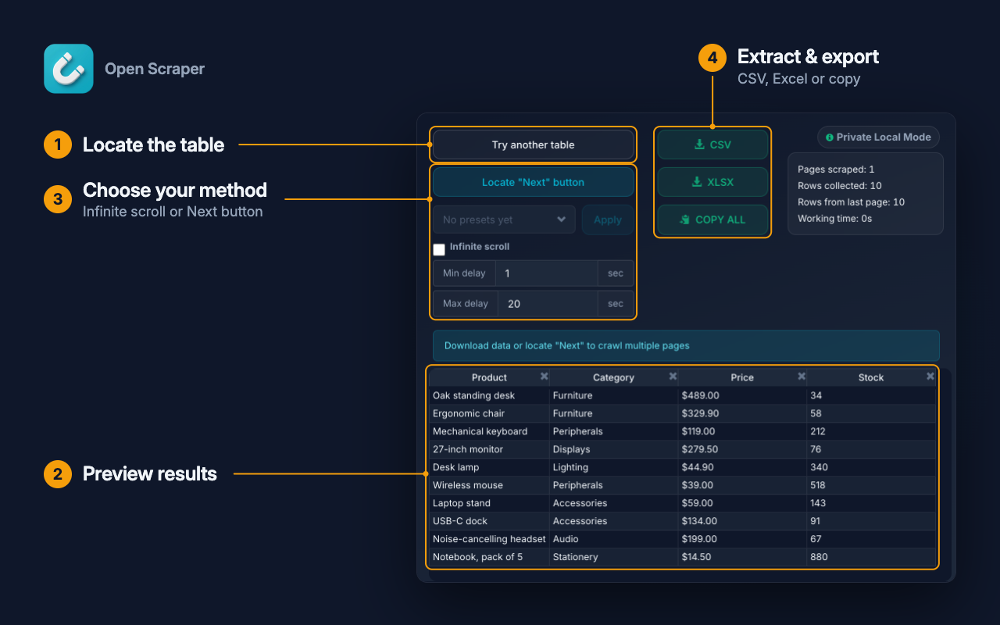
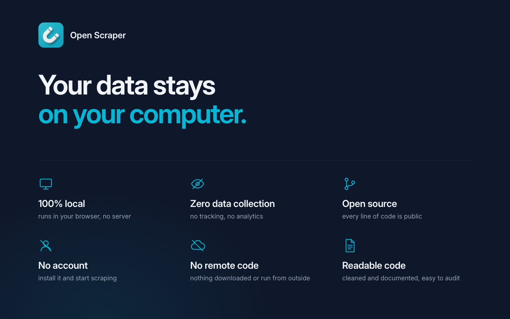

# Open-Scraper

A free, secure, and improved fork of the popular **"Instant Data Scraper"** extension.

**📦 Available on the Chrome Web Store:** [Install Open-Scraper](https://chromewebstore.google.com/detail/open-scraper/bbolpnicmijleigcpabhabogobmbnkmd)

## 📸 Overview

## ⚠️ Context: Why this project?

Attention all OSINT investigators and enthusiasts.

The highly popular Chrome extension **Instant Data Scraper** recently changed hands (moving from *Web Robots* to an entity named *Flavr Technology, LP*). According to Micah Hoffman (@WebBreacher), a key figure in the community, this change in ownership makes the tool "no longer safe" to use.

🚩 **Why you should be concerned:**
- **Opaque change of ownership**: Extensions acquired by third parties are often turned into vectors for advertising data collection, or even malware/spyware.
- **Privacy risk**: As a scraping tool, the extension has access to the content of the pages you visit. Your sensitive research could be compromised.
- **OSINT-FR Warning**: The alert coming from Micah Hoffman is taken very seriously by the global OSINT community.

🔨 **What should you do?**
1. **UNINSTALL** the original extension from your browser immediately.
2. **CHECK** your other extensions: the practice of buying free tools to inject malicious code is common.

## 🚀 The Project: What we implemented

Faced with this security risk, **Open-Scraper** was created starting from the base of version 1.4.1 of the original extension, before its acquisition. We have sanitized and improved the code:

- **Security and Transparency**: Fully open-source and auditable code, ensuring no background data collection or communication with shady third-party servers.
- **Refactoring**: Complete cleanup of the source code (formerly heavily obfuscated) to make it readable, documented (JSDoc), and easy to maintain. Removed dead code (stubs).
- **UI/UX Improvements**:
  - Max column width limit (200px) to prevent unreadable results tables (especially with long URLs).
  - Smart text truncation (`text-overflow: ellipsis`).
- **Bug Fixes**: Resolved critical issues related to automatic table detection.

## ⚙️ Setup: How to install the extension

### Option 1 (recommended): Chrome Web Store

Open the [Open-Scraper page on the Chrome Web Store](https://chromewebstore.google.com/detail/open-scraper/bbolpnicmijleigcpabhabogobmbnkmd) and click **"Add to Chrome"**. Updates are automatic. It also works on Chromium-based browsers (Brave, Edge...).

### Option 2: Manual install from source

For those who want to audit the code or run the latest development version:

1. **Get the code**:
   - Clone this repository to your machine: `git clone https://github.com/Lygobate/Open-scraper.git`
   - *Or* download the code as a ZIP archive (via the green "Code" button > "Download ZIP" on GitHub) and extract it.
2. **Open Chrome** (or a Chromium-based browser like Brave, Edge) and go to: `chrome://extensions/`
3. Enable **"Developer mode"** (toggle in the top right corner).
4. Click on the **"Load unpacked"** button (top left).
5. Select the extracted folder that contains the `manifest.json` file.

### Firefox (coming soon)

The Firefox version is coming soon on addons.mozilla.org. Meanwhile, the same source folder works in Firefox: open `about:debugging`, go to **"This Firefox"**, click **"Load Temporary Add-on…"** and pick the `manifest.json` file (the add-on is removed when Firefox closes).

Maintainers: `node scripts/package.mjs` builds the single zip (`dist/open-scraper-<version>.zip`) uploaded to both stores.

Whichever option you choose, the Open-Scraper extension will appear in your list and will be immediately functional and secure to use!
